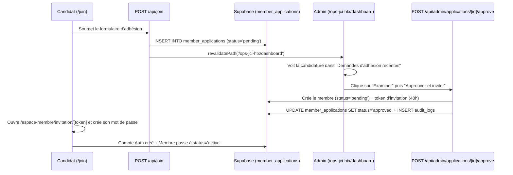

@AGENTS.md

# Architecture Complète du Site — JCI Tabarre Excelsior & JCI National (`CLAUDE.md`)

## 1. Présentation Générale

Plateforme web institutionnelle, portail membres et système d'administration (ERP associatif) conçu pour **JCI Tabarre Excelsior** et extensible à **JCI National (JCI Haïti)**.

La plateforme s'articule autour de **3 espaces** :
1. **Vitrine Publique (`app/(public)/`)** : Présentation de l'organisation, initiatives et réalisations (accessibles sans connexion), formulaire d'adhésion (`/join`), formulaire de contact (`/contact`).
2. **Portail Membres (`app/espace-membre/`)** : Tableau de bord personnel, score d'engagement sur 100 pts, inscriptions aux activités et formations, gestion des tâches assignées par les commissions, suivi des cotisations et édition du profil.
3. **Panel d'Administration Comité Directeur (`app/ops-jci-htx/`)** : Tableau de bord exécutif en temps réel, examen et approbation/rejet des demandes d'adhésion, gestion des membres et attribution des rôles JCI, création/archivage d'activités, import de présences Google Sheets, délégation de tâches par commission et journal d'audit complet (traçabilité).

---

## 2. Stack Technique

| Couche | Technologie | Détails |
| :--- | :--- | :--- |
| **Framework** | Next.js 16.2.9 (App Router) | Turbopack en build (`next build`), Webpack en dev (`next dev --webpack`) |
| **Langage** | TypeScript 5 | Typage strict bout-en-bout |
| **Styles & UI** | Tailwind CSS 4 + PostCSS | Charte JCI : Navy (`#1B2454` / `#1e3a8a`), Cyan (`#45C4E0` / `#06b6d4`), Montserrat & Inter |
| **Base de données** | Supabase (PostgreSQL) | Row Level Security (RLS) activé sur toutes les tables |
| **Authentification** | Supabase Auth (`@supabase/ssr`) | Cookies HTTP-only gérés par `proxy.ts`, récupération de mot de passe intégrée |
| **CMS Hybride** | Sanity Client + Fallback statique | Lecture Sanity avec repli automatique sur les initiatives authentiques JCI (`defaultInitiatives`) |
| **Emails** | Resend (`lib/email/resend.ts`) | Notifications d'adhésion, invitations membres avec token 48h (tolérant au mode démo) |
| **Rate Limiting** | Upstash Redis (`lib/utils/rateLimit.ts`) | Protection anti-abus sur `/api/join`, `/api/contact`, `/api/auth/accept-invitation` |
| **Validation** | React Hook Form 7 + Zod 4 | Validation client & serveur des schémas (`lib/utils/schemas.ts`) |
| **Déploiement** | Netlify (`netlify.toml`) | URL de production : `https://jci-excelsior.netlify.app` |

---

## 3. Arborescence Complète du Projet

```text
jci-tabarre-excelsior/
├── app/
│   ├── (public)/                        # Vitrine publique (sans authentification)
│   │   ├── page.tsx                     # Accueil : Hero, Stats, Mission, Initiatives, CTA
│   │   ├── about/page.tsx               # Histoire, Bureau (CDL), Galerie des Past-Présidents
│   │   ├── initiatives/
│   │   │   ├── page.tsx                 # Catalogue filtrable des initiatives (InitiativesFilterList)
│   │   │   └── [slug]/page.tsx          # Détail complet d'une initiative + résultats d'impact
│   │   ├── join/page.tsx                # Formulaire d'adhésion (18–40 ans)
│   │   └── contact/page.tsx             # Formulaire de contact
│   │
│   ├── auth/                            # Flux transverses d'authentification
│   │   ├── mot-de-passe-oublie/page.tsx       # Demande de lien de réinitialisation (Admin & Membre)
│   │   └── reinitialiser-mot-de-passe/page.tsx# Saisie du nouveau mot de passe via token Supabase
│   │
│   ├── espace-membre/                   # Portail privé des Membres JCI
│   │   ├── layout.tsx                   # Barre de navigation membre & vérification de session
│   │   ├── connexion/                   # Connexion membre (MemberLoginForm)
│   │   ├── invitation/[token]/          # Activation initiale du compte (token 48h)
│   │   ├── tableau-de-bord/page.tsx     # Score d'engagement (100 pts), cotisations, activités
│   │   ├── activites/page.tsx           # Calendrier & inscription en 1 clic aux activités
│   │   ├── formations/page.tsx          # Parcours de formation JCI & progression
│   │   ├── taches/page.tsx              # Missions confiées au membre & mise à jour de statut
│   │   └── profil/page.tsx              # Mise à jour des informations personnelles & bio
│   │
│   ├── ops-jci-htx/                     # Panel d'Administration (Comité Directeur)
│   │   ├── layout.tsx                   # Sidebar admin & contrôle d'accès par rôle
│   │   ├── login/                       # Connexion administrateur (AdminLoginForm)
│   │   ├── dashboard/page.tsx           # KPIs temps réel, demandes d'adhésion récentes, alertes
│   │   ├── candidatures/
│   │   │   ├── page.tsx                 # Liste et compteurs des candidatures (En attente/Approuvées/Rejetées)
│   │   │   └── [id]/page.tsx            # Examen détaillé + boutons Approuver / Rejeter (ReviewButtons)
│   │   ├── membres/
│   │   │   ├── page.tsx                 # Annuaire membres, filtres, invitation directe
│   │   │   └── [id]/page.tsx            # Fiche membre : cotisations, rôles JCI (AssignRoleButton), présences
│   │   ├── activites/
│   │   │   ├── page.tsx                 # Gestion des activités, réunions et formations
│   │   │   ├── nouveau/page.tsx         # Création d'une activité
│   │   │   └── [id]/                    # Détail, archivage/statut (ActivityStatusActions), import Sheets, édition
│   │   ├── taches/page.tsx              # Délégation des tâches par commission JCI (TaskListClient)
│   │   └── audit/page.tsx               # Journal d'audit & traçabilité (AuditLogClient)
│   │
│   └── api/                             # Routes API Backend (Route Handlers)
│       ├── join/route.ts                # POST : Enregistrement candidature en base + emails Resend
│       ├── contact/route.ts             # POST : Envoi message de contact
│       ├── revalidate/route.ts          # POST : Webhook de revalidation ISR Sanity
│       ├── auth/accept-invitation/      # POST : Création compte Auth + activation membre
│       ├── member/
│       │   ├── profile/route.ts         # PUT : Mise à jour profil par le membre
│       │   ├── activities/[id]/register/# POST/DELETE : Inscription/désinscription activité
│       │   └── tasks/                   # GET/PATCH : Lecture et avancement des tâches du membre
│       └── admin/
│           ├── applications/[id]/
│           │   ├── approve/route.ts     # POST : Approbation candidature -> création membre + token 48h + audit
│           │   └── reject/route.ts      # POST : Rejet candidature + motif + audit
│           ├── members/
│           │   ├── invite/route.ts      # POST : Invitation directe d'un membre + audit
│           │   └── [id]/
│           │       ├── dues/route.ts    # POST : Validation cotisation annuelle + audit
│           │       └── role/route.ts    # POST : Attribution de rôle (CDL / Commission) + audit
│           ├── activities/
│           │   ├── route.ts             # POST : Création d'activité + audit
│           │   └── [id]/
│           │       ├── route.ts         # PUT/DELETE : Modification / archivage / suppression + audit
│           │       └── import/route.ts  # POST : Import présences depuis Google Sheets
│           └── tasks/
│               ├── route.ts             # GET/POST : Liste et assignation de tâches + audit
│               └── [id]/route.ts        # PUT/DELETE : Validation / modification / suppression de tâche + audit
│
├── components/
│   ├── admin/Sidebar.tsx                # Navigation latérale du panel d'administration
│   ├── layout/                          # Header, Footer, MobileDrawer
│   ├── sections/                        # HeroSection, StatsSection, InitiativesFilterList, JoinForm, etc.
│   └── ui/                              # Button, Card, Badge, SectionHeader, Spinner, SanityImage
│
├── lib/
│   ├── supabase/
│   │   ├── client.ts                    # Client Supabase navigateur (@supabase/ssr)
│   │   ├── server.ts                    # createClient(), createServiceClient(), requireActiveAdmin()
│   │   ├── engagement.ts                # Calcul du score d'engagement sur 100 points
│   │   └── types.ts                     # Interfaces TypeScript de la base de données
│   ├── sanity/                          # Client Sanity + requêtes + données de repli (defaultInitiatives)
│   ├── email/resend.ts                  # Instance différée Resend
│   └── utils/                           # schemas.ts (Zod), security.ts (escapeHtml, UUID, IP), rateLimit.ts
│
├── supabase/migrations/                 # Migrations SQL ordonnées
│   ├── 001_initial_schema.sql           # Tables initiales + RLS de base
│   ├── 002_member_applications.sql      # Table member_applications + colonnes profil
│   ├── 003_admin_self_read.sql          # Policy RLS admin_self_read sur admin_users
│   └── 004_tasks_and_delegation.sql     # Table tasks + policies RLS tâches
│
├── proxy.ts                             # Middleware Next.js 16 de protection des routes
├── netlify.toml                         # Configuration de build et d'environnement Netlify
├── plan.md                              # Feuille de route vers JCI National
└── correct.md                           # Post-mortem des erreurs et règles anti-régression
```

---

## 4. Architecture de la Base de Données Supabase & Sécurité RLS

### 4.1. Tables Principales

1. **`members`** : Profil complet des membres (`user_id`, `first_name`, `last_name`, `email`, `phone`, `birth_date`, `commune`, `profession`, `education_level`, `interests`, `status` [`pending` | `active` | `inactive` | `alumni`], `jci_level` [`member` | `senator` | `alumnus`], `community_role`, `join_date`).
2. **`member_applications`** : Demandes d'adhésion soumises depuis `/join` (`status` : `pending` | `approved` | `rejected`, `reviewed_by`, `reviewed_at`, `review_notes`, `member_id`).
3. **`admin_users`** : Comptes du Comité Directeur (`user_id`, `name`, `email`, `role` [`president` | `secretaire` | `charge_formation` | `charge_communication` | `tresorier`], `is_active`).
4. **`activities`** : Formations, réunions, activités et initiatives (`type`, `status` [`upcoming` | `ongoing` | `completed` | `cancelled`], `activity_date`, `location`, `capacity`, `google_sheet_id`).
5. **`attendances`** : Émargement et inscriptions aux activités (`activity_id`, `member_id`, `attended`, `source` [`google_form` | `manual` | `site`]).
6. **`tasks`** : Répartition des tâches par commission JCI (`title`, `description`, `commission`, `assigned_to`, `assigned_by`, `activity_id`, `priority` [`basse` | `normale` | `haute` | `urgente`], `status` [`a_faire` | `en_cours` | `termine` | `valide`], `due_date`).
7. **`dues`** : Cotisations annuelles des membres (`member_id`, `year`, `amount`, `paid_at`, `confirmed_by`).
8. **`member_roles`** : Historique des postes occupés par chaque membre (`role_title`, `commission`, `start_date`, `end_date`, `is_current`).
9. **`member_invitations`** : Tokens d'activation valables 48h envoyés lors de l'approbation d'une candidature ou d'une invitation directe.
10. **`audit_logs`** : Journal infalsifiable de toutes les actions administratives (`admin_id`, `action`, `target_type`, `target_id`, `details` JSONB, `ip_address`, `created_at`).

### 4.2. Modèle de Sécurité (Proxy + RLS + Service Role)

- **`proxy.ts` (Middleware Next.js 16)** :
  - Intercepte toutes les requêtes vers `/ops-jci-htx/*` et `/espace-membre/*`.
  - Vérifie la session Supabase Auth et l'appartenance active à `admin_users` pour `/ops-jci-htx/*`.
  - Injecte `x-admin-role` et `x-admin-name` dans les en-têtes de requête pour éviter les doubles requêtes réseau dans `app/ops-jci-htx/layout.tsx`.
- **`requireActiveAdmin(allowedRoles?)` (`lib/supabase/server.ts`)** :
  - Vérifie systématiquement côté serveur dans chaque route API `/api/admin/*` que l'appelant est connecté, présent dans `admin_users` avec `is_active = true`, et possède le rôle requis.
- **Séparation des clients Supabase (`lib/supabase/server.ts`)** :
  - `createClient()` : Client de session utilisant les cookies de l'utilisateur connecté (soumis aux politiques RLS `member_self_read`, `admin_self_read`, etc.).
  - `createServiceClient()` : Client serveur privilégié utilisant `SUPABASE_SERVICE_ROLE_KEY` (validée par `HAS_VALID_SERVICE_KEY`) pour les opérations administratives et l'insertion publique sécurisée dans `member_applications`.

---

## 5. Flux Fonctionnels Clés

### 5.1. Flux d'Adhésion et d'Activation d'un Nouveau Membre


### 5.2. Calcul du Score d'Engagement (`lib/supabase/engagement.ts`)
Calculé dynamiquement sur **100 points** :
- **Présence aux activités** : jusqu'à **40 points** (au prorata des activités terminées).
- **Formations complétées** : jusqu'à **25 points** (5 pts par formation, max 5).
- **Cotisation annuelle à jour** : **20 points**.
- **Rôle actif (Commission ou Comité)** : **15 points**.
- **Paliers** : *Inactif* (0–30) · *Actif* (31–60) · *Très actif* (61–85) · *Champion* (86–100).

---

## 6. Déploiement & Variables d'Environnement (Netlify)

- **URL de production** : `https://jci-excelsior.netlify.app`
- **Fichier de configuration** : `netlify.toml`
  - Configure `NEXT_PUBLIC_SITE_URL`, `NEXT_PUBLIC_SUPABASE_URL`, `NEXT_PUBLIC_SUPABASE_ANON_KEY`.
  - Configure `SECRETS_SCAN_OMIT_KEYS` et `SECRETS_SCAN_OMIT_PATHS` pour éviter les faux positifs du scanner Netlify sur les variables publiques.
- **Variables secrètes à renseigner dans l'interface Netlify (*Site configuration > Environment variables*)** :
  - `SUPABASE_SERVICE_ROLE_KEY` : Clé secrète `sb_secret_...` (indispensable en production pour que le serveur puisse insérer et lire `member_applications`, `audit_logs`, etc. en contournant RLS).
  - `RESEND_API_KEY` : Clé API Resend (`re_...`) pour l'envoi effectif des e-mails Transactionnels.
